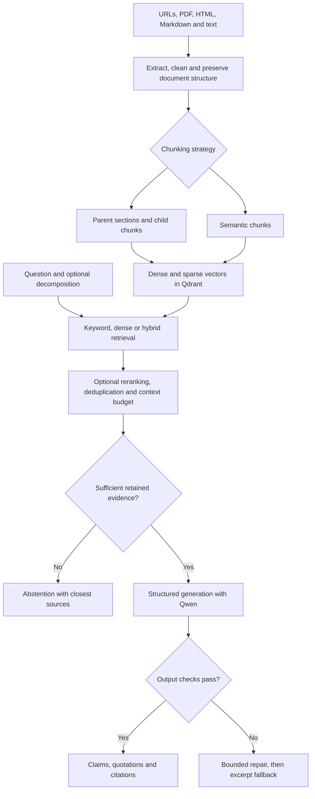

# EdgeDocs Copilot

**A retrieval-augmented generation assistant for technical documentation, with configurable retrieval, incremental indexing, source-linked answers and an evaluation pipeline.**

EdgeDocs Copilot helps engineers explore workflows involving PyTorch, ONNX, ONNX Runtime and related deployment tools. It searches a selected documentation corpus, assembles supporting passages, and asks a local language model to produce an answer linked to those passages. When evidence is missing or generated output fails validation, it abstains or returns clearly labeled excerpts.

A representative question is:

> I have trained an image classification model in PyTorch. How can I export it to ONNX and deploy it using ONNX Runtime? Explain the necessary steps and identify potential compatibility issues.

The project explains these workflows from documentation; it does not train, export or deploy the user's models.

**Implementation:** [EdgeDocsCopilotRAGSystem.ipynb](EdgeDocsCopilotRAGSystem.ipynb)  
**Interface:** Jupyter/Google Colab notebook with answers, expandable source panels, tables and plots.  
**Status:** Experimental RAG prototype. Retrieval and evaluation are implemented; reliable answer generation remains the main improvement area.

## Contents

- [Architecture](#architecture)
- [Document ingestion and incremental indexing](#document-ingestion-and-incremental-indexing)
- [Chunking strategies](#chunking-strategies)
- [Retrieval and reranking](#retrieval-and-reranking)
- [Evidence checks and answer generation](#evidence-checks-and-answer-generation)
- [Evaluation methodology](#evaluation-methodology)
- [Recorded execution results](#recorded-execution-results)
- [What the results demonstrate](#what-the-results-demonstrate)
- [Areas for improvement](#areas-for-improvement)
- [Running the notebook](#running-the-notebook)
- [Exported artifacts](#exported-artifacts)

## Architecture

The application separates document preparation from question answering. Indexing prepares reusable representations of the corpus; answering searches those representations and supplies selected evidence to the language model.



### Main components

| Component | Implementation and purpose |
| --- | --- |
| Language and interface | Python, Jupyter/IPython, pandas and Matplotlib |
| Document extraction | BeautifulSoup/Markdown conversion for HTML; PyMuPDF4LLM with a PyMuPDF text fallback for PDF |
| Dense embedding model | `BAAI/bge-small-en-v1.5`, producing normalized 384-dimensional embeddings |
| Sparse retrieval | Custom identifier-aware BM25-style encoding with Qdrant's IDF weighting |
| Vector store | Persistent embedded Qdrant by default; remote connection settings are also available |
| Fusion | Reciprocal Rank Fusion, through Qdrant or a manual implementation |
| Reranker | `cross-encoder/ms-marco-MiniLM-L-6-v2` |
| Answer model | `qwen2.5:3b` through Ollama in the recorded run |
| Alternative providers | Optional Anthropic and OpenAI-compatible clients; not evaluated in this run |
| Observability | Ingestion reports, source panels, stage timings, output diagnostics and exported traces |

The default answering configuration uses **semantic chunking and dense retrieval**, with query decomposition and reranking disabled. Other configurations remain available for comparison. Keyword or hybrid answering invokes the cross-encoder to obtain the relevance score used by the evidence gate; plain keyword/hybrid retrieval benchmarks do not include that additional answering step.

## Document ingestion and incremental indexing

### Extraction and cleaning

The pipeline accepts individual URLs, local files and folders. It converts each supported source into a common document representation, then parses content into headings, paragraphs, lists, code and tables.

For HTML, the extractor attempts to locate the main article and remove navigation, scripts, banners and other boilerplate. Code blocks are preserved separately during Markdown conversion. PDF extraction retains page information and attempts structured Markdown extraction before falling back to plain text. Repeated page headers and footers are removed heuristically.

Cleaning removes empty content and repeated blocks while preserving code case and formatting. Deduplication is scoped around headings so that identical examples under different sections do not automatically lose their context. Extraction failures are recorded in the ingestion report rather than silently treated as successfully indexed documents.

Each chunk stores its source, title, heading path, document type and available page metadata. This supports both retrieval and inspection of where an answer's evidence came from.

### Incremental updates

The pipeline maintains a per-collection manifest containing source hashes, chunk IDs and chunking settings:

- If extracted content and chunking settings are unchanged, existing chunks are reused.
- For an updated document, newly identified chunks are embedded and upserted, while obsolete chunks are deleted.
- Chunk identity includes heading information, so changing a section's meaning through its heading can trigger an update.
- `force=True` re-embeds the document; `remove_missing=True` synchronizes removal of sources absent from the supplied list.
- Documents with identical content retain separate source identities.

Collection configuration checks prevent accidentally querying or extending an index with incompatible embedding settings. Extracted source snapshots and atomic JSON manifest writes support inspection and reproducibility. These are local prototype safeguards, not a transactional or concurrent indexing service.

Incremental reuse saves embedding work; it does not imply that remote sources can be checked without downloading/extracting them again.

## Chunking strategies

### Parent–child chunking

Documents are divided into heading-based parent sections. Smaller child chunks are embedded and searched; the corresponding parent text is available for answer generation.

This separates the search unit from the reading context: a focused child passage can match a question while its parent supplies surrounding explanation. Multiple children from the same parent are deduplicated before the final selection consumes its passage slots.

Configured size targets are approximately **900 tokens per parent**, **220 per child**, and **40 tokens of child overlap**.

### Semantic chunking

The semantic strategy builds units from sentences and structural blocks, embeds each unit with neighboring context, and measures cosine distance between adjacent units. Larger changes in meaning can become chunk boundaries, subject to section and size constraints.

The configuration uses the **85th percentile** of within-document distances as a breakpoint threshold, with a target minimum of **80 tokens** and maximum of **350**. Small trailing groups may be merged, so the maximum is not an absolute bound in every case. Code and tables are attached to their introducing text where size permits.

Semantic chunking performs extra embedding work before the final chunks are embedded for indexing. This explains why it can be substantially slower to build than parent–child chunks.

All chunk/context token counts use a word-and-punctuation estimate, not the answer model's exact tokenizer.

## Retrieval and reranking

### Keyword retrieval

The sparse encoder retains technical identifiers and expands their components. For example, `torch.onnx.export` can contribute both the full identifier and component terms; `InferenceSession` can contribute its full name and constituent words.

Document weights use a BM25-style term-frequency and length-normalization calculation, with Qdrant supplying IDF weighting. The configured average document length is a fixed approximation rather than a recomputed corpus average. This makes the sparse leg useful for literal API terminology, but it should not be treated as an exact reproduction of every standard BM25 implementation.

### Dense retrieval

The embedding model represents questions and passages in the same vector space. Questions receive the model's retrieval instruction, and normalized vectors are compared using cosine similarity.

Dense retrieval can retrieve related explanations even when a question and document use different wording. A high similarity score nevertheless indicates relevance, not proof that the passage answers every part of the question.

### Hybrid retrieval

Hybrid retrieval combines sparse and dense rankings using Reciprocal Rank Fusion. Each result receives contributions based on its rank in each list, avoiding a direct addition of incompatible raw score scales.

The configuration retrieves up to **50 candidates per hybrid leg**, retains **20 candidates**, and selects up to **5 unique context units** for answering. The manual fusion implementation uses `sum(1 / (k + rank))`, with configured `k=60`. Qdrant also supports a compatibility fallback to its default fusion behavior if custom RRF parameters are unavailable.

### Cross-encoder reranking and query decomposition

The cross-encoder jointly evaluates a question and candidate passage, then reorders the candidates. This requires additional inference per pair and is considerably more expensive than searching precomputed vectors. Its scores are passed through a sigmoid, but they are not calibrated probabilities of correctness.

Optional query decomposition uses an LLM to identify libraries, keywords and up to four subqueries. Results can be merged across queries. The original question's relevance score is retained for gating; a strong match to one easy subquestion should not by itself justify answering the whole request. Decomposition was disabled in the recorded end-to-end run.

## Evidence checks and answer generation

### Context construction and abstention

Selected passages are deduplicated and assigned source IDs such as `[S1]`. Parent context is preferred for parent–child retrieval; if it does not fit the budget, matched child text may be used instead. Passages that still do not fit are skipped. The configured evidence budget is approximately **2,200 tokens**.

The evidence gate checks the context that actually survives this process. It considers the best retained original-question relevance score and whether specified constraints—such as named frameworks, hardware terms or numeric precision—appear in the retained evidence or its metadata.

The provisional dense threshold is **0.50**; the cross-encoder threshold is **0.005**. These scores use different scales and are not interchangeable. Thresholds and vocabulary checks are heuristics, not a general answerability classifier.

### Structured output and validation

Instead of relying on a request to “include citations,” the model is asked to return structured claims containing:

- The claim text.
- An existing source ID.
- A supporting quotation copied from that source.

The validator checks output structure, source IDs, quotation matching after whitespace normalization, quotation length, repetition, and certain numerical/API details. It also includes a limited check for dropped exceptions. Citations are then rendered by the application.

The default permits **one repair attempt**. If the model still fails the checks, the application returns labeled source excerpts rather than presenting the rejected synthesis as an answer. Excerpts can also be returned when no language model is available. Empty claims with an explanation can represent a model abstention.

**Passing these checks does not prove factual support or completeness.** The recorded provider-answer example demonstrates this limitation: a valid quotation can omit the adjacent sentence containing an important exception.

## Evaluation methodology

The notebook contains **10 questions**: **8 labeled answerable** and **2 deliberately unanswerable**. The positive questions cover export, inference sessions, providers, ONNX validation, OpenCV, OpenVINO, opset compatibility and a compound deployment workflow.

Relevance labels specify a source substring, required terms and a relevance grade. They are transparent and reproducible, but source-specific matching may fail to credit an alternative valid passage.

| Metric | Meaning in this notebook |
| --- | --- |
| Recall@k | Fraction of positive evidence specifications credited within the top k results. Each hit credits at most one previously uncredited specification. |
| EvidenceCoverage@k | Fraction of specifications matched by any of the top k hits; one passage can satisfy multiple specifications. |
| MRR | Mean reciprocal rank of the first hit credited with relevant evidence. |
| nDCG@k | Discounted ranking quality using graded, deduplicated specification matches. |
| Final-context coverage | Fraction of specifications found in the context actually retained for answering. |
| Answer mode | Distinguishes accepted structured output, excerpt fallback and abstention. |
| Citation diagnostics | Detects invalid IDs and heuristically flags uncited sentences or technical terms absent from the sources. |
| Stage latency | Separates retrieval, reranking and generation from total question time. |

Retrieval averages exclude the two negative questions. The complete evaluation includes all ten. A separate covered-subset report excludes positive questions whose labeled evidence was not ingested. Neither Recall@k nor successful output validation is an answer-accuracy measurement.

## Recorded execution results

These figures come from the outputs saved in the supplied notebook. Embeddings and Qwen ran on **CPU**. They describe one execution, not repeated trials or a controlled before/after comparison. Model downloads and initialization are separate from the per-query timings below.

### 1. Corpus and ingestion

Nine sources were requested; **eight ingested successfully**. The OpenCV documentation request returned **HTTP 403**, leaving **12 of 14 evidence specifications** represented in the corpus.

| Ingestion measure | Parent–child | Semantic |
| --- | ---: | ---: |
| Indexed chunks | 243 | 208 |
| Total wall time | 116.91 s | 473.80 s |
| Extraction | 15.24 s | 11.40 s |
| Cleaning | 0.06 s | 0.08 s |
| Chunking | 0.10 s | 334.14 s |
| Final-chunk embedding | 97.48 s | 124.89 s |
| Indexing | 3.87 s | 3.14 s |

Semantic chunking produced about **14.4% fewer chunks** but took about **4.1 times longer** to ingest. Its chunking time includes the additional embeddings used to identify semantic boundaries. Fewer chunks therefore did not mean cheaper preprocessing.

The local update demonstration also exercised the incremental path: a three-chunk Markdown document was reused unchanged; editing one section added one chunk, deleted one old chunk and reused two. Removing a second file from the supplied source list removed it from the demonstration collection.

### 2. Semantic retrieval comparison

The following averages cover **all eight positive questions**, including the missing-source OpenCV question.

| Retriever | Recall@5 | Recall@10 | MRR | nDCG@5 | nDCG@10 | Mean search + reranking |
| --- | ---: | ---: | ---: | ---: | ---: | ---: |
| Keyword/BM25 | 0.438 | 0.531 | 0.534 | 0.478 | 0.510 | 9.5 ms |
| Dense | **0.656** | 0.656 | 0.604 | **0.565** | 0.565 | 70.6 ms |
| Hybrid/RRF | 0.531 | 0.656 | 0.501 | 0.479 | 0.515 | 78.5 ms |
| Dense + cross-encoder | 0.469 | **0.688** | **0.656** | 0.538 | **0.612** | 6,365.3 ms |
| Hybrid + cross-encoder | 0.469 | 0.594 | 0.652 | 0.538 | 0.580 | 6,242.7 ms |

EvidenceCoverage@5 and @10 equal the corresponding Recall values in this particular table, although their implementations differ.

Dense retrieval delivered the strongest top-5 evidence coverage. The dense reranker improved MRR and Recall@10, but reduced Recall@5 and added several seconds. It sometimes moved a relevant result earlier while distributing other required evidence less favorably within the top five. Higher MRR therefore did not imply a more complete answer context.

These results support the dense-only baseline for this small experiment; they do not establish that hybrid retrieval or reranking is generally inferior.

### 3. Covered-subset results

Removing the OpenCV question leaves **seven positive questions whose labels are represented in the corpus**. This separates document availability from retrieval ranking, while the full-set results above preserve the real ingestion failure.

| Retriever | Recall@5 | Recall@10 |
| --- | ---: | ---: |
| Keyword/BM25 | 0.500 | 0.607 |
| Dense | **0.750** | 0.750 |
| Hybrid/RRF | 0.607 | 0.750 |
| Dense + cross-encoder | 0.536 | **0.786** |
| Hybrid + cross-encoder | 0.536 | 0.679 |

The dense score of **0.750 is evidence recall on seven questions**, not “75% answer accuracy.”

### 4. Chunking comparison

A separate comparison evaluated both collections with the same positive questions and retrieval methods.

| Retriever | Parent–child Recall@5 | Semantic Recall@5 | Parent–child Recall@10 | Semantic Recall@10 |
| --- | ---: | ---: | ---: | ---: |
| Keyword/BM25 | 0.469 | 0.438 | 0.531 | 0.531 |
| Dense | 0.531 | **0.656** | 0.656 | 0.656 |
| Hybrid/RRF | 0.531 | 0.531 | 0.656 | 0.656 |
| Dense + cross-encoder | 0.469 | 0.469 | 0.656 | 0.688 |
| Hybrid + cross-encoder | 0.469 | 0.469 | 0.656 | 0.594 |

For dense retrieval, semantic chunks improved Recall@5 by **0.125**, while Recall@10 was unchanged. Parent–child dense retrieval had higher MRR (**0.657 versus 0.604**), illustrating that first-hit ranking and total evidence coverage measure different properties. No strategy wins every metric.

Parent–child relevance matching can examine the parent text, whereas semantic matching examines the chunk itself. The comparison therefore includes the different context supplied by each design, rather than comparing only equally sized passage representations.

### 5. End-to-end answers

The answering evaluation used semantic chunks, dense retrieval, no decomposition or reranking, and local Qwen2.5:3B.

| Question | Output mode | Final-context coverage | Total time |
| --- | --- | ---: | ---: |
| PyTorch → ONNX export | Excerpt fallback | 0.00 | 434.624 s |
| ONNX Runtime inference session | Structured | 1.00 | 550.000 s |
| Execution-provider configuration | Structured | 1.00 | 74.579 s |
| Validate an ONNX model | Excerpt fallback | 1.00 | 389.909 s |
| OpenCV inference | Abstained: missing evidence | 0.00 | 0.146 s |
| Convert to OpenVINO | Excerpt fallback | 1.00 | 313.031 s |
| ONNX opset support | Excerpt fallback | 1.00 | 425.881 s |
| Compound export/deployment workflow | Excerpt fallback | 0.25 | 265.679 s |
| Qualcomm Hexagon INT4 | Abstained | N/A | 0.072 s |
| TensorRT INT8 calibration caches | Abstained | N/A | 0.059 s |

The run completed without a recorded question-level exception, but completion is not the same as successful generation:

- **2 of 10** questions returned accepted structured answers.
- **5 of 10** returned extractive fallbacks after generation failed validation.
- **3 of 10** triggered abstention: both deliberately negative questions and the OpenCV question affected by failed ingestion.

Generation was attempted for seven questions. Only **2/7, or 28.6%**, produced accepted structured output; **5/7, or 71.4%**, fell back to excerpts. These percentages measure output-contract acceptance, not factual correctness. The fallback preserves access to evidence but should not be counted as a completed synthesized answer.

Final-context coverage also needs interpretation. The export question's label requires a PyTorch documentation source, so a relevant ONNX Runtime export tutorial can still receive no credit. Conversely, coverage of 1.00 only establishes that the specified source/terms are present; it does not establish that the model used them correctly.

### 6. Latency and token usage

| Stage | Mean | Median | 95th percentile |
| --- | ---: | ---: | ---: |
| Retrieval | 0.080 s | 0.077 s | 0.117 s |
| LLM generation | 245.316 s | 289.272 s | 498.008 s |
| Total | 245.398 s | 289.355 s | 498.081 s |

These averages include three questions that skipped generation. Across the seven questions where generation was attempted, mean total time was approximately **350.5 seconds**, including repair attempts where applicable. The ten-question answering loop took approximately **40.9 minutes**, excluding ingestion, setup and the separate retrieval experiments.

Generation accounted for more than **99.9%** of the reported average total latency. Fast vector search is therefore not the main obstacle to an interactive experience in this CPU run. Reranking is a separate cost visible in the retrieval comparisons; it was disabled in this answering evaluation.

The summary recorded **23,000 input tokens** and **3,125 output tokens**. Reported API cost was **$0 for local Ollama inference**, which excludes hardware, electricity and runtime costs. Chunk-size token estimates and provider-reported generation token counts are different measurements.

### 7. Citation checks and the remaining exception error

The evaluation recorded **zero invalid citation IDs** and **zero flagged technical terms absent from the supplied sources**. It also reported **98 heuristically uncited sentences**, all in fallback rows. Fallback excerpts are labeled by source at the passage level, so this sentence-based count is not a direct measure of hallucination or factual error.

A more substantive issue appears in the displayed execution-provider answer. The model stated that an execution provider must be specified, while the retrieved passage also described an exception for CPU execution. The chosen quotation excluded that neighboring exception, allowing the answer to pass the current checks.

This identifies a specific validation weakness: **checking the selected quotation is insufficient when a nearby qualification changes the scope of the claim**. The system must evaluate the claim against the surrounding passage as well. Source IDs, literal quotations and complete factual support are separate requirements.

## What the results demonstrate

The strongest evidence is the implemented retrieval and indexing workflow: multiple document formats, two chunking strategies, sparse/dense/hybrid comparisons, incremental updates, inspectable evidence and separate quality/latency measurements.

The evaluation also provides useful negative findings. Reranking did not improve top-5 coverage here, semantic preprocessing was expensive, one source was unavailable, and structured generation frequently failed despite relevant evidence being retrieved. Reporting those observations makes the system's current capabilities easier to assess.

The current notebook is suitable as an **experimental engineering portfolio project**. It does not yet demonstrate a consistently accurate, responsive documentation assistant. No human answer-accuracy score or broad generalization claim is supported by this ten-question run.

## Areas for improvement

| Priority | Improvement | Motivation from the run |
| --- | --- | --- |
| 1 | Validate claims against surrounding context, including exceptions and negations | The provider answer passed checks while omitting the CPU exception. |
| 2 | Inspect failed generation traces and improve the claim/quotation workflow | Five of seven generation attempts ultimately used fallback excerpts. The notebook summary does not expose every rejected draft. |
| 3 | Evaluate GPU inference and alternative model sizes/settings | CPU generation dominates response time. Any speed or quality gains need measurement. |
| 4 | Recover unavailable documentation using accessible sources or local copies | OpenCV ingestion failed, leaving two labels unmatched and causing an abstention. |
| 5 | Improve evidence diversity for multi-step questions | The compound question retained only 0.25 of its labeled evidence. Decomposition and per-aspect retrieval should be tested rather than assumed beneficial. |
| 6 | Calibrate gates on an independent development set | Both negative questions exceeded the dense similarity threshold; missing-constraint checks caused abstention. Similarity alone was insufficient. |
| 7 | Expand and manually review the evaluation set | Ten questions and two negatives cannot establish reliable accuracy or abstention performance. |
| 8 | Strengthen reproducibility and deployment behavior | Freeze corpus/model revisions, use exact tokenizers where needed, and add concurrency/error handling before packaging as a service. |

Threshold tuning and configuration selection should use a development split, followed by evaluation on held-out questions. Review correctness, completeness and citation support separately from formatting acceptance. A local model judge may be a diagnostic aid, but should not replace independent human assessment.

## Running the notebook

1. Open `EdgeDocsCopilotRAGSystem.ipynb` in Jupyter or Google Colab and run the dependency-installation cell.
2. Execute the configuration and definitions in order. A GPU runtime is preferable for local generation; verify the printed model placement rather than assuming GPU use.
3. At the LLM configuration cell, keep Ollama/Qwen enabled for generated answers, or set `cfg.llm_provider = "none"` for retrieval with labeled excerpts.
4. Initialize the components, inspect `SOURCES`, and run ingestion for both collections if comparing chunking methods. Review failed sources before interpreting evaluation scores.
5. Ask questions and run the retrieval/end-to-end evaluation cells. The full local-model evaluation can take substantial time on CPU.

```python
ask("How do I create an inference session in ONNX Runtime?", mode="dense")
```

To use your own documents, update `SOURCES` and ingest them. Revise the evaluation labels to match the new corpus rather than treating the original questions as a valid benchmark for unrelated documents.

If embedding settings change, initialize the corresponding models and use a fresh collection prefix before re-indexing. Embedded Qdrant should not be opened concurrently by multiple processes using the same local storage folder.

## Exported artifacts

Results are written to `Path(cfg.workdir) / "results"`, normally `/content/edgedocs/results` in Colab.

| File | Contents |
| --- | --- |
| `ingestion_times.csv` | Stage timings for both chunking strategies |
| `retrieval_summary.csv` | Aggregate retrieval metrics |
| `retrieval_per_query.csv` | Per-question retrieval results |
| `chunking_comparison.csv` | Results across both chunking strategies |
| `retrieval_covered_summary.csv` | Retrieval results excluding questions with unavailable labeled evidence |
| `label_coverage.csv` | Corpus coverage for each evidence specification |
| `end_to_end.csv` | Answer modes, coverage, latency, tokens and diagnostics |
| `answer_traces_*.json` | Full answers, supplied contexts, generation attempts and validation errors |
| `eval_set.json` | Evaluation questions and relevance labels |
| `run_environment.json` | Package versions, configuration and source information |
| `human_review.csv` | Answers with blank fields for human correctness, completeness and citation-support ratings |

Download these exports before ending a temporary Colab session. The recorded metrics in this README are visible in the executed notebook; exported files should be committed separately if they are to be made available in the repository. Blank human-review fields must not be interpreted as completed evaluation.
